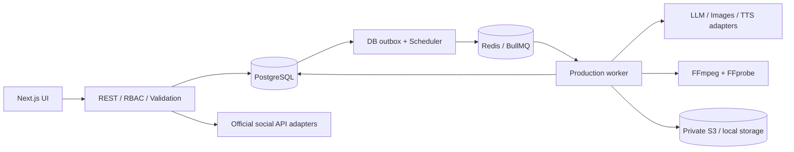

# Kiến trúc AI Video Automation Studio

## Quyết định

Next.js App Router + TypeScript phục vụ UI tiếng Việt và REST API. PostgreSQL/Prisma là nguồn dữ liệu chuẩn; Redis/BullMQ là hàng đợi có thể tái tạo. Worker Node.js độc lập chạy orchestrator, scheduler, AI adapters, FFmpeg và QA. S3/MinIO lưu tài sản riêng tư; filesystem adapter dùng cho phát triển. Không tạo video trong request HTTP.

## Ranh giới

- `src/app`: UI, route handler; không chứa API key.
- `src/server`: auth/session, authorization, CRUD, storage, queue, budget, scheduler.
- `src/domain`: schemas, state machine, subtitle/time/QA pure functions.
- `src/providers`: hợp đồng provider, OpenAI-compatible LLM, OpenAI images/TTS, official social adapters.
- `src/worker`: xử lý nền, checkpoint từng scene/version, reconciliation, graceful shutdown.
- `src/render`: lệnh FFmpeg dạng argv (không shell), Unicode ASS, probe/decode QA.

## Reliability

API ghi video + ProductionJob trong một transaction. Dispatcher đưa job DB vào BullMQ theo id ổn định. Job có lease PostgreSQL, owner token và heartbeat; một worker mất lease phải ngừng pipeline. Từng asset có unique(project, revision, scene, kind); retry tái dùng asset đã hoàn thành. Unknown outcome của API trả phí được lưu và cần người dùng quyết định trước khi gọi lại. Scheduler giữ cron/timezone/nextRunAt trong DB, lấy advisory transaction lock và unique occurrence để tránh lặp. Jobs hết attempts lưu FAILED và có hàng đợi dead-letter. Mọi kết quả được ghi theo tenant.

## Trust & dữ liệu

Session ngẫu nhiên 256-bit, DB chỉ lưu hash; password dùng scrypt. RBAC OWNER/EDITOR/REVIEWER/VIEWER. Kiểm tra Origin cho mutation. Secret mã hóa AES-256-GCM. Provider endpoint chỉ nhận hostname admin cho phép; request nguồn không fetch URL tùy ý. API trả signed download hoặc stream đã kiểm tra tenant, không public bucket. Không ghi token/key vào audit/error.

## Phạm vi MVP và hướng mở rộng

Luồng ưu tiên: tạo tài khoản → tạo kênh → cấu hình provider → chủ đề/script → ảnh/TTS từng scene → ASS/SRT/VTT → MP4/QA → duyệt/export. Các tính năng rộng của Phase 3/4 có trạng thái rõ trong IMPLEMENTATION_PLAN.md; không dùng số liệu giả hay trạng thái published giả để lấp phần chưa thực hiện. Triển khai nhiều worker bằng replica, local storage phải đổi sang shared S3.

## Biên tập AI và cộng tác workspace

ScriptEditJob dùng hàng đợi studio-script-edits riêng với dispatcher DB outbox, lease/heartbeat, retry và dead-letter. Job không thay đổi video/script khi sinh đề xuất. Áp dụng proposal dùng cùng transaction lock theo project với lưu script và khóa scene; kiểm tra baseRevision, scene khóa và ghi ScriptVersion, đồng thời vô hiệu output/approval và proposal cũ. Timeout giữ chi phí UNKNOWN. WorkspaceInvitation chỉ lưu token hash; các thay đổi role/invite tuần tự hóa theo workspace, đọc lại quyền OWNER và bảo vệ ít nhất một owner.

## Cập nhật kiến trúc nâng cao

Tenant API chạy qua AsyncLocalStorage + Prisma client dùng studio_tenant; startup connection option cố định app.workspace_id. SQL RLS kiểm soát cả bảng gốc và bảng con. Worker/authentication dùng adminDb; đó là trust boundary phải bảo vệ ở tầng mạng và secrets.

Production/script-edit dùng BullMQ + DB leases. Các vòng maintenance (publishing, webhook, analytics/recommendations, retention) chạy độc lập có guard chống overlap trong process. Lease/atomic claims bảo vệ các task nhiều worker; scheduler heartbeat không bị chặn bởi API upload chậm.

AutomationTask lưu research/search/remote clip/thumbnail/recommendations; output và request đều gắn workspace. clip remote ID được lưu trước polling; retry không tự tạo paid request mới khi kết quả chưa biết.
